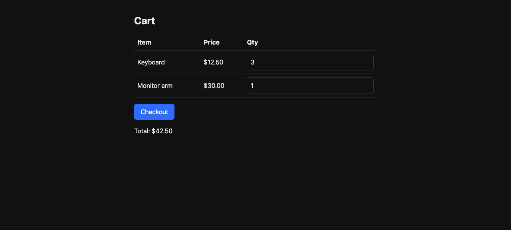

# agent-qa-bot

**Autopilot QA for teams that ship with AI agents.** A Devin Bot wakes up on every PR, deploy or Sentry spike. It opens the real app in a browser, goes through it like a user would, and files a Linear ticket with a repro and a fix PR. Then it posts the verdict in Slack.

Agents write more code than humans can click through. This repo is the harness that does the clicking.

## What's here today

| Part | What it does |
|---|---|
| `lab/` | A small Bun app with the hard parts of real UIs: form validation, login with an HttpOnly session cookie, a cart that calls an API, a native `confirm()` dialog, and a form inside an iframe. `BUG=checkout` seeds a regression. |
| `bench/` | Runs user journeys through the [agent-browser](https://github.com/vercel-labs/agent-browser) CLI. It times every action, checks every outcome, and writes `results/*.md` and `results/*.json`. With `--video`, every failing journey is replayed on camera into `results/videos/`. It exits non-zero on failure, so CI can gate on it. |
| `devin/` | The Devin Bot playbook: triggers, steps, and what a good bug report looks like. |
| `.github/workflows/qa.yml` | Runs the bench on every PR, checks the seeded bug is caught with a video, posts the verdict as a PR comment and uploads the report. Green on Ubuntu in under a minute. |

## Run it

```bash
bun install
bun add -g agent-browser && agent-browser install
bun run qa        # healthy app: 7/7 pass
bun run qa:bug    # seeded checkout bug: the bot catches it and records a video repro
```

## First results

Run on agent-browser 0.43.0, macOS, against the local lab:

| Run | Scenarios | Actions | p50 / p95 per action |
|---|---|---|---|
| Healthy | **7/7 pass** | 37 | 10 ms / 107 ms |
| `BUG=checkout` (quantity ignored in the total) | **6/7, regression caught** | 37 | 9 ms / 107 ms |

The checkout scenario fails with `expected "$67.50", got "$42.50"`. That's exactly the kind of bug an agent-written PR can ship with green unit tests.

**Video repro:** [`results/videos/checkout-total-respects-quantities.webm`](results/videos/checkout-total-respects-quantities.webm). Quantity set to 3, Checkout clicked, total stuck at $42.50.



### Findings in the tools themselves

- **agent-browser 0.43: `find` ignores the selected iframe.** After `frame "#newsletter"`, `find label Email fill …` reports "No element found". `fill "#nl-email" …` works. The iframe scenario uses CSS selectors until this is fixed.
- **agent-browser action policy:** the documented `eval` category doesn't block `eval` (the policy has to say `evaluate`), and `get` doesn't cover `get title`. Found while benchmarking browser agents before this repo existed.

## Roadmap

1. **Devin Bot wiring.** Triggers on GitHub PRs, Vercel/Cloudflare deploy hooks and Sentry alerts, plus Slack and Linear outputs. See [`devin/bot.md`](devin/bot.md).
2. ~~**Video repros.**~~ Shipped: `--video` records every failing journey.
3. **Exploratory mode.** Besides fixed journeys, the bot dogfoods the changed pages and reports anything broken.
4. **Public benchmark.** The same journeys across computer-use tools (agent-browser, Playwright MCP, desktop accessibility drivers), with success rate and latency per action.

## License

MIT
